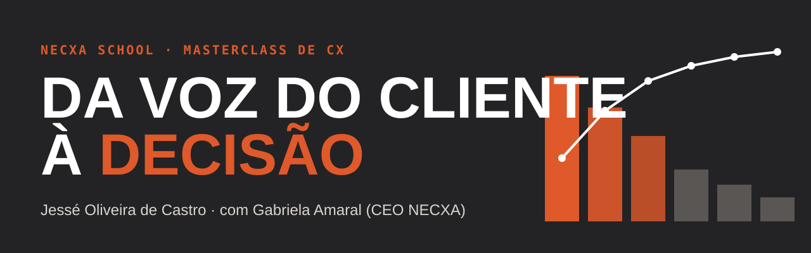
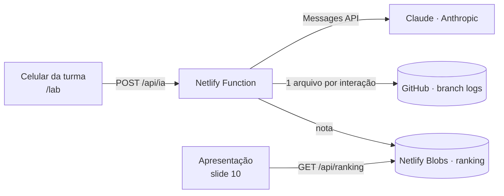

<p align="center">
  
</p>

<p align="center">
  <a href="https://necxaschool.com"></a>
  
  
  
</p>

<p align="center">
  <b>Métodos para encontrar a causa raiz, priorizar o que realmente dói e colocar a IA para trabalhar junto com o time de CX.</b><br>
  Material da masterclass da <a href="https://necxaschool.com"><b>NECXA School</b></a>, a convite de <b>Gabriela Amaral</b> (CEO da NECXA),<br>
  apresentado por <a href="https://portfolio-jesseoliveiracastro.netlify.app/"><b>Jessé Oliveira de Castro</b></a>.
</p>

---

## Sobre a aula

A turma da [NECXA School](https://necxaschool.com) trabalha todos os dias com pesquisas de satisfação para capturar a voz do cliente. As duas dores mais comuns:

1. **Entender a causa raiz** do problema com método, e não com a intuição de quem fala mais alto.
2. **Priorizar** entre dezenas de jornadas que parecem todas urgentes.

O formato é um misto de apresentação e bate-papo: o material guia a conversa, e uma IA treinada com o conteúdo participa ao vivo, tirando dúvidas e jogando com a turma.

## O roteiro

| # | Slide | O que acontece |
|---|-------|----------------|
| 1 | **Capa** | Um Pareto ilustrativo se desenha na tela: poucas jornadas concentram a maior parte da dor. |
| 2 | **Data Driven no centro** | As decisões metodológicas antes de abrir qualquer projeto: análise quantitativa (Paretos, Reclame Aqui, monitoria, coeficiente de variação), qualitativa (correlação com CSAT, VoC, safras, speech analytics no NPS, CES) e priorização. |
| 3 | **Volume × Dor** | Matriz interativa com 8 jornadas fictícias. Mexa nos pesos de NPS, CSAT, CES e resolutividade e veja o roadmap se reorganizar em *agora · próximo · depois*. |
| 4 | **Cliente no centro** | A estrutura de atuação em órbita: processos, qualidade, letramento, comunicação interna e base de conhecimento girando em volta do cliente, com a melhoria contínua como motor. |
| 5 | **AS IS → TO BE** | Fluxo fictício de contestação de compra: 9 etapas e 5 dores viram 6 etapas com o cliente no controle. |
| 6 | **A provocação** | *Como a IA pode nos ajudar?* |
| 7 | **Capturar** | Um comentário de cliente vira cinco dados (canal, tema, sentimento, esforço e ação). Plataformas como Medallia e Birdie. |
| 8 | **Trabalhar junto** | O escritório de agentes de IA (Cowork) conectado a projeto, e-mails, pastas, JIRA e roadmap, com arquitetura de escalonamento: o agente faz, o agente propõe, você decide. |
| 9 | **Conectar** | MCP e RAG explicados com animação. |
| 10 | **Laboratório ao vivo** | QR code para a turma entrar no Jessé·IA e no Desafio Causa Raiz, com ranking em tempo real. |
| 11 | **Para levar** | Calculadora RICE, este repositório e o portfólio do Jessé. |

> Navegação: setas do teclado, espaço, swipe no celular ou os botões no canto. `F` liga a tela cheia. Cada slide tem endereço próprio (`#datadriven`, `#priorizacao`, `#asis-tobe`…).

## O Laboratório Jessé·IA

Acessível em **`/lab`** (pensado para o celular da turma).

- **Pergunte ao Jessé·IA**: chat com o Claude, da Anthropic, usando o conteúdo da aula como base de conhecimento. Um RAG simples na prática.
- **Desafio Causa Raiz**: a IA gera um caso fictício com dados de atendimento (volume, CSAT, CES, resolutividade, CV, comentários e pista da monitoria). O participante aponta causa raiz, evidência e prioridade; a IA avalia o método e dá nota de 0 a 100.
- **Ranking**: melhor nota de cada apelido, exibido também no slide 10.
- **Log no repositório**: cada interação vira um arquivo JSON no branch [`logs`](../../tree/logs), em `logs/AAAA-MM-DD/`. Material de estudo para a turma depois da aula.



## Como publicar no Netlify

1. No Netlify: **Add new site → Import an existing project** e escolha este repositório. Não precisa de comando de build (o `netlify.toml` já cuida disso).
2. Em **Site configuration → Environment variables**, cadastre:

| Variável | Obrigatória | Para quê |
|---|---|---|
| `ANTHROPIC_API_KEY` | sim | Chave da API da Anthropic ([console.anthropic.com](https://console.anthropic.com)). |
| `GITHUB_TOKEN` | para os logs | Token *fine-grained* com acesso só a este repositório e permissão **Contents: Read and write**. |
| `ANTHROPIC_MODEL` | não | Padrão `claude-sonnet-5-5`. Use `claude-haiku-5-5` para gastar menos. |
| `ACCESS_CODE` | não | Código da turma. Se definido, o lab pede o código antes de responder. Bom para evitar uso fora da aula. |
| `GITHUB_REPO` | não | Padrão `Jesse-DataDriven/Apresenta-o-NECXA`. |
| `LOG_BRANCH` | não | Padrão `logs`. |
| `RATE_LIMIT` | não | Interações por pessoa a cada 10 minutos. Padrão `40`. |

3. Faça o deploy. O branch `logs` é criado sozinho na primeira interação, e o `netlify.toml` impede que os commits de log disparem novos deploys.

### Rodando localmente

```bash
npm install
npx netlify-cli dev   # sobe o site e as funções em http://localhost:8888
```

## Estrutura

```
├── index.html               # a apresentação (11 slides, 1600×900 escalado)
├── lab.html                 # o laboratório da turma (mobile-first)
├── netlify/
│   ├── functions/
│   │   ├── ia.mjs           # chat, geração de caso e avaliação
│   │   └── ranking.mjs      # ranking do desafio
│   └── lib/
│       ├── conteudo.mjs     # o que a IA sabe: conteúdo da aula e personas
│       └── util.mjs         # Anthropic, log no GitHub, ranking, limite de uso
├── assets/banner.svg
├── netlify.toml
└── package.json
```

Quer mudar o que a IA responde? Edite `netlify/lib/conteudo.mjs`. Todos os dados dos exemplos (Pareto, matriz, fluxo e comentários) são **fictícios**.

## Ferramentas abertas para a turma

- **[Calculadora RICE](https://calcrice.netlify.app/)**: RICE normalizado com Custo do Atraso (CoD), IA ajudando a priorizar e montar roadmaps, e calculadora de margem de erro para pesquisas. Gratuita e open source.
- **[Portfólio do Jessé](https://portfolio-jesseoliveiracastro.netlify.app/)**: projetos, cases e contato.

## Créditos

- **[NECXA School](https://necxaschool.com)** · Gabriela Amaral, CEO, pelo convite e pela turma.
- **Jessé Oliveira de Castro** · conteúdo, métodos e cases. [GitHub](https://github.com/Jesse-DataDriven) · [Portfólio](https://portfolio-jesseoliveiracastro.netlify.app/)
- IA do laboratório: [Claude](https://www.anthropic.com/claude), da Anthropic.

<p align="center"><sub>Feito com dados, café e cliente no centro.</sub></p>
